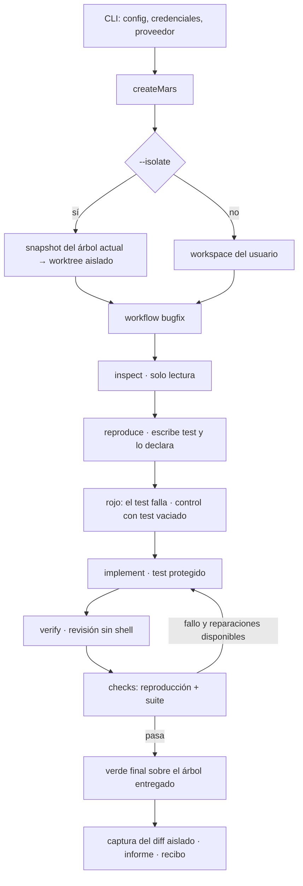

# Arquitectura de MARS

Estado: 25-oct-2026, `main` en `ecd817d`. Documento técnico: cómo fluye una tarea, qué garantiza cada pieza y dónde están sus límites. Para un recorrido sin detalles internos, lee la [guía rápida](guia-rapida.md). Las decisiones de diseño y sus pruebas están en los [ADR](decisions/).

## La idea en una frase

El modelo **propone**; MARS **ejecuta, limita y comprueba**. El resultado de una tarea no es el mensaje final del modelo, sino un **recibo**: qué se cambió, qué comandos se ejecutaron de verdad, con qué resultado, y —para un bug— la prueba de que estaba roto antes y arreglado después.

## Paquetes

```text
apps/cli            CLI `mars`: comandos, REPL interactiva, render de eventos
packages/sdk        createMars(): orquesta sesión, workflows, presupuesto, contrato, informes y recibos
packages/core       bucle del agente (runAgent), mensajes, eventos, errores, compactación
packages/providers  adaptadores de modelos: OpenAI, Codex (suscripción ChatGPT), Anthropic, Gemini, Qwen, Kimi, OpenRouter, Ollama, fake
packages/tools      herramientas del workspace (leer, escribir, buscar, git, shell), checks, MCP, sandbox Docker
packages/runtime    workspace y permisos, config, sesiones, contexto y skills, routing, workflows, evidencia, memoria, aislamiento Git
packages/auth       credenciales en el llavero del sistema, OAuth, integración con el login de Codex
evals/              corpus de tareas con tests ocultos y runner comparativo (no forma parte del paquete npm)
```

Dependencias en un solo sentido: `cli → sdk → (runtime, tools, providers, auth) → core`.

## Recorrido de una tarea

Ejemplo: `mars run "paginate devuelve la página siguiente" --workflow bugfix --isolate --receipt recibo.md`



1. **Arranque (CLI).** Carga la configuración en este orden de precedencia: flags, entorno, proyecto (`.mars/config.json`) y usuario. Resuelve credenciales desde el llavero del sistema y crea el proveedor. Ejemplo: `openai-codex:gpt-5.6-sol`.
2. **Sesión (SDK, `createMars`).** Abre el workspace con sus fronteras de rutas. Con `--isolate` crea un worktree desechable (ver [Aislamiento](#aislamiento)). Registra herramientas, servidores MCP y permisos. Carga instrucciones del proyecto (`AGENTS.md`, `.mars/instructions.md`), memoria aprobada y skills relevantes.
3. **Workflow.** Una secuencia de fases, cada una con rol, instrucción y herramientas permitidas. Cada fase es una llamada a `runAgent`.
4. **Bucle del agente (`core/agent-loop.ts`).** Pide al modelo, ejecuta las tool calls que devuelve, añade los resultados y repite hasta una respuesta sin herramientas. Aplica límites de turnos, tool calls, tiempo y contexto; reintenta errores transitorios si se configura; guarda un checkpoint tras cada turno.
5. **Verificación.** MARS, no el modelo, ejecuta los comandos de verificación y decide por exit code. Un check solo pasa con exit 0; no encontrar checks cuenta como fallo.
6. **Cierre.** Captura el diff aislado, completa el informe (`RunReport`) y, con `--receipt`, escribe el recibo Markdown.

## Workflows incluidos

| Workflow | Fases | Uso |
| --- | --- | --- |
| `bugfix` | inspect → **reproduce** → implement → verify | Arreglar un bug con prueba rojo→verde |
| `feature` | plan → implement → verify | Cambios sin reproducción previa |
| `review` | review → verify | Revisar el diff actual sin escribir |

Las fases de solo lectura no pueden escribir aunque el modelo lo intente: el ejecutor deniega cualquier herramienta fuera de `allowedTools`. `bugfix` y `feature` admiten de 0 a 3 reparaciones tras un check fallido (`--repair-attempts`).

## La prueba de un bugfix

Detalle y casos de prueba en el [ADR 008](decisions/008-bugfix-proof-contract-and-receipts.md).

| Paso | Qué exige MARS | Qué evita |
| --- | --- | --- |
| Reproducción | El agente escribe un test que cubre el comportamiento exigido por el informe (la regla o especificación, no solo el ejemplo) y llama a `declare_reproduction({ command, files, reported, covers, cases })`. `reported` es el ejemplo del propio informe tal como lo comprueba el test, y el recibo lo muestra. En esta fase solo puede escribir tests o archivos nuevos; shell y MCP están denegados | Romper código de producción para fabricar un fallo |
| Comando | Debe nombrar los tests declarados y no usar código inline (`node -e`, `python -c`…). Todo archivo que nombre queda protegido | Comandos que mencionan el test sin ejecutarlo |
| Rojo | El comando falla sin firmas de error de carga (sintaxis, módulo inexistente, comando inexistente) | Tests que fallan por una razón ajena al bug |
| Control | Con los tests declarados vaciados, el resultado debe cambiar | Fallos que no dependen del test |
| Contrato | Los tests de reproducción y los globs de `contract.protect` no se pueden escribir. Sus hashes se comprueban tras el rojo, después de cada comando de verificación y al final | Debilitar el test para que pase |
| Verde final | Tras todas las fases y checks, la reproducción se repite sobre el árbol entregado y debe pasar | Un verde obsoleto |

El recibo muestra `covers` y `cases` como alcance declarado por el agente: *Fixed and proven* garantiza esos casos, no el resto del contrato. Lo que quede fuera solo lo cubren los checks del proyecto.

**Test desactualizado.** Si el código ya cumple el contrato y lo que falla es un test existente, el agente edita ese test y llama a `declare_outdated_test({ command, files, reason })` en lugar de `declare_reproduction`. MARS lo comprueba sobre el código sin cambios: los archivos deben ser tests existentes editados en esa fase, la versión original debe fallar por una aserción y la editada debe pasar. Después no hay fase de arreglo, los tests editados quedan protegidos y se ejecutan los checks. El veredicto es *Test change proposed* (⚠️). Nunca cuenta como éxito automático, porque decidir qué expectativa es la correcta corresponde a una persona.

Veredictos del recibo: *Fixed and proven*, *Test change proposed*, *Verified*, *Contract violated*, *Not proven*, *Failed*, *Completed without verification*.

### Con un motor externo (`--engine claude|codex`)

Una CLI de agente (Claude Code `claude -p` o `codex exec`) hace el trabajo de `bugfix` en dos turnos de una misma sesión. MARS comprueba entre turno y turno:

1. **Turno 1 (motor):** escribe el test que reproduce el bug, sin arreglarlo, y termina con una declaración en JSON estructurado (`kind`, `command`, `files`, `reported`, `covers`, `cases` o `reason`), con los mismos límites que `declare_reproduction`/`declare_outdated_test`.
2. **MARS:** compara el árbol antes y después del turno. Si cambió algún archivo existente que no sea test, rechaza la ejecución. Después aplica las mismas comprobaciones que antes (rojo, control, contrato) o, si el motor declaró un test desactualizado, comprueba el test.
3. **Turno 2 (misma sesión):** arregla el código sin tocar los tests protegidos. Si los checks fallan, las reparaciones vuelven a esa sesión.
4. **MARS:** contrato por hashes, checks, verde final y recibo.

MARS ya no está entre el motor y sus escrituras, así que las reglas se comprueban **después** de cada turno (diff y hashes): no se impiden. La shell del motor corre en su propio sandbox. Claude Code se lanza con `--bare`: se autentica **solo con `ANTHROPIC_API_KEY`** y nunca lee el login de claude.ai, porque Anthropic no permite que herramientas de terceros funcionen con credenciales de una suscripción de Claude. Además no carga CLAUDE.md, hooks, plugins ni MCP del usuario. Las ediciones se aceptan y la shell queda limitada a `npm` y `node`. Codex corre en su sandbox `workspace-write`, sin red ni aprobaciones. Los dos usan esfuerzo bajo por defecto. Para depurar, `MARS_ENGINE_TRACE=<archivo>` guarda la salida cruda de cada turno. El presupuesto de peticiones y tokens no limita al motor por dentro: solo cuentan el tiempo y los turnos que MARS lanza.

## Aislamiento

`--isolate` ([ADR 007](decisions/007-isolated-runs-and-task-budget.md)):

- La **base** es un commit del estado actual del árbol, incluidos cambios sin commitear y archivos no ignorados. Se crea con un índice temporal: el índice, el stash y las ramas del usuario no se tocan.
- El **worktree** vive en la carpeta de datos del usuario (`%LOCALAPPDATA%\mars\worktrees\<repo>\<id>` en Windows, `~/.local/share/mars/worktrees/…` en el resto; `MARS_WORKTREES_DIR` la cambia), fuera del árbol de trabajo y fuera de `.git`, donde Claude Code y Codex no dejan editar. Las ejecuciones creadas antes conservan su worktree en `<git-common-dir>/mars/worktrees/<id>`. `node_modules` se enlaza para que los checks funcionen.
- Refs `refs/mars/runs/<id>/base` y `.../result`: el diff entre ambas es **solo** trabajo del agente.
- `mars runs diff|apply|discard`. `apply` comprueba antes de aplicar y no toca el índice; si no aplica limpio, no cambia nada.
- Las operaciones Git propias de MARS ignoran hooks (directorio privado vacío) y filtros definidos por el agente (atributos leídos del commit base). Requiere Git ≥ 2.40. No admite submódulos ni el sandbox Docker por ahora.

## Presupuesto

Un único presupuesto por operación (`budget.maxDurationMs`, `maxModelRequests`, `maxTokens`), compartido por fases, reparaciones, reintentos y checks. Se comprueba antes de cada petición al modelo. Agotarlo produce `BudgetExceededError` y nunca deja un recibo de éxito. Los tokens que el proveedor no comunica se marcan como desconocidos en lugar de contarse como cero.

## Proveedores

Interfaz común `ModelProvider.stream(request, signal)` en `core/providers.ts`.

- **`openai-codex`** usa la suscripción de ChatGPT a través del binario oficial de Codex, con `--ignore-user-config`. Así no carga los plugins ni los servidores MCP del usuario: un turno pasa de ~240 s a ~7 s en una configuración de escritorio típica. MARS mantiene el hilo entre turnos, pide salida estructurada (contenido + tool calls) y hace únicos los IDs de llamada entre fases. La cancelación espera a que termine todo el árbol de procesos.
- **APIs** (OpenAI, Anthropic, Gemini, Qwen, Kimi, OpenRouter, Ollama): HTTP con streaming SSE y API key en el llavero.
- **`fake:scripted`**: determinista, para tests y demos sin red.

## Seguridad y permisos

- **Archivos:** todas las rutas se resuelven dentro del workspace. Se bloquean enlaces, rutas reservadas y archivos sensibles (`.env`, `.ssh`, claves…). La búsqueda y `git diff` aplican la misma frontera.
- **Shell:** política `allow`/`ask`/`deny`; comandos destructivos, de red, commit y push con políticas propias. El modo host **no es un sandbox del sistema operativo**; `--sandbox docker` aísla en un contenedor sin red.
- **MCP:** servidores stdio configurados por el usuario; se tratan como código de confianza.
- **Recibos:** nunca incluyen prompts ni respuestas del modelo. Redactan credenciales reconocibles, escapan Markdown/HTML y muestran rutas relativas.

## Datos en disco

| Ubicación | Contenido |
| --- | --- |
| `.mars/config.json` | Configuración del proyecto |
| `.mars/sessions/` | Sesiones reanudables (`mars resume ID`) |
| `.mars/events.jsonl` | Eventos de ejecución, sin texto del modelo |
| `.mars/evidence.json` | Contadores de éxito de workflows y skills |
| `.mars/knowledge.json` | Memoria y procedimientos propuestos/aprobados |
| `.git/mars/`, `refs/mars/runs/` | Worktrees y refs de ejecuciones aisladas |
| Llavero del sistema | Credenciales (Credential Manager, Keychain, Secret Service) |

## Evals

`evals/` mide el producto, no el runtime ([ADR 009](decisions/009-evals.md)):

- Cada tarea trae un repo, un **test oculto** que el agente nunca ve y una solución de referencia. `node evals/validate.mjs` comprueba el corpus sin modelo.
- `node evals/run.mjs` ejecuta MARS y el modelo sin MARS sobre las mismas tareas.
- La métrica principal es la **falsa prueba**: el recibo dice *Fixed and proven* y el test oculto falla. Se clasifica por los tests ocultos que fallan: `reported` si falla el ejemplo del informe (`reportedTests` de la tarea), es decir, la prueba era falsa; `scope` si fallan otros casos del contrato que la reproducción no cubría; `checks` si fallan los checks del proyecto.

Resultados en [evals/RESULTS.md](../evals/RESULTS.md).

## Límites conocidos

- El control con test vaciado detecta fallos independientes del contenido del test. No detecta un test que dependa de su contenido pero falle por otra razón.
- Un archivo protegido que se modifica y se restaura entre dos comprobaciones no es detectable.
- `--ignore-user-config` no desactiva el `AGENTS.md`, las skills ni las reglas del usuario de Codex.
- La shell en modo host corre con los permisos del usuario.
- Las fases A y B se han probado en Windows (suite completa y ejecuciones reales). macOS y Linux están previstos en el diseño (grupos de procesos POSIX, symlinks), pero no se han ejecutado con estos cambios.
